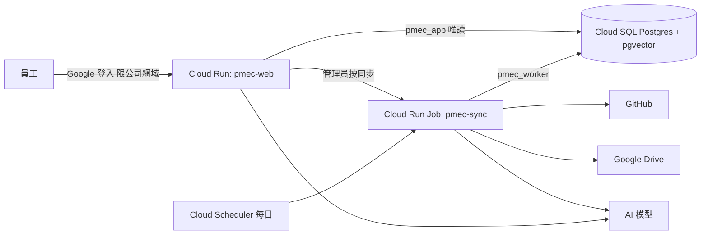
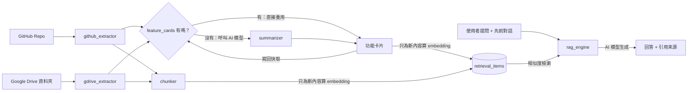

# PMEC Tool — 知識庫助理

內部知識庫工具。透過 RAG 架構，把工程團隊的 README / API 規格 / 已合併 PR，
以及（選填）Google Drive 指定資料夾內的組織文件，轉譯成知識卡片；使用者提問時，
助理先判斷問題意圖（事實查詢、進度狀態、操作說明、彙整比較、對客戶承諾評估、閒聊），
再依意圖產生回答並標註引用來源。

可以裝在四種環境（導入手冊的「套餐」）：
- **試用版**：公司一台常開的電腦／NAS，`docker compose up -d`（沒有 Docker 的 Linux／WSL：`bash scripts/local_stack.sh`）
- **地端版**：同上，再加 `--profile ollama` 跑地端模型，資料不出公司
- **雲端版**：Google Cloud Run＋外部 PostgreSQL（例如 Neon 免費方案），`deploy/deploy.env` 設 `DB_MODE=external`
- **企業雲版**：Google Cloud Run＋Cloud SQL（`DB_MODE=cloudsql`）

AI 模型由客戶自選（國網 RAP、OpenAI、Anthropic Claude、OpenRouter、Gemini、Ollama 或任何 OpenAI 相容端點，見 `src/llm.py`）。
登入：Google、Microsoft Entra ID（單一租用戶），或 Cloudflare Access（email 驗證碼，驗證簽章後才信任）。

## 快速開始（新客戶）

```bash
python -m src.setup_wizard     # 回答問題 → 產生 tenant.toml、.env、.streamlit/secrets.toml（雲端版另有 deploy/deploy.env）
docker compose up -d --build   # 或 bash scripts/local_stack.sh；雲端版：bash deploy/gcp_setup.sh && bash deploy/deploy.sh
```

## 架構

```
project-root/
├── app.py                    # Streamlit 介面（登入關卡、問答、管理員同步）
├── src/
│   ├── config.py             # 環境變數
│   ├── auth.py               # 登入後的存取判斷（公司網域、管理員）
│   ├── db.py                 # PostgreSQL 連線、schema 遷移、網頁唯讀角色
│   ├── documents.py          # 各來源共用的原始文件結構 ExtractedDocument
│   ├── github_extractor.py   # 透過 PyGithub 抓取 README、API 規格、近期 Merged PR
│   ├── gdrive_extractor.py   # 透過 Google Drive API 讀取指定資料夾（含子資料夾）文件
│   ├── card_cache.py         # 功能卡片快取（feature_cards 表），避免重複消耗 AI 模型額度
│   ├── summarizer.py         # 呼叫 AI 模型將 Raw Code/PR/文件轉譯為功能卡片
│   ├── chunker.py            # 把文件原文切成段落（試算表逐列保留欄名），供細節檢索
│   ├── index_store.py        # pgvector 檢索索引 + 本地多語 ONNX Embedding（fastembed）
│   ├── sync_pipeline.py      # 抓取 → 快取 → 摘要 → 索引的同步協調器，記錄於 sync_runs
│   ├── rag_engine.py         # 檢索卡片與原文段落，依問題意圖產生回答
│   ├── jobs.py               # 從網頁觸發 Cloud Run 同步工作
│   ├── llm.py / llm_anthropic.py  # 客戶自選的 AI 模型（OpenAI 相容＋Anthropic 官方 SDK）
│   ├── scheduler.py          # 非 Google Cloud 環境的排程：網頁同步請求＋每日同步
│   ├── cf_access.py          # 驗證 Cloudflare Access 登入憑證（AUTH_MODE=cloudflare）
│   ├── setup_wizard.py       # 安裝精靈
│   └── worker.py             # 背景工作入口：migrate / sync / reembed
├── migrations/               # Alembic schema 版本
├── deploy/                   # GCP 一次性建置（gcp_setup.sh）與部署（deploy.sh）
├── scripts/
│   ├── dev_db.py                   # 本機啟動內嵌 PostgreSQL（含 pgvector）
│   ├── migrate_card_cache.py       # 一次性：把舊版 GitHub 上的卡片快取匯入資料庫
│   ├── check_llm_connection.py     # 手動驗證 AI 模型連線
│   └── check_gdrive_connection.py  # 手動驗證 Google Drive 憑證與資料夾權限
└── tests/
```

### 部署架構



### 資料流



會呼叫 AI 模型（花額度）的只有 `summarizer`（新文件的功能卡片，送文件前 6,000 字）與 `rag_engine`（生成回答，送相關段落）；
embedding 在服務內以 ONNX 模型計算，文字不送往第三方。

## 企業設定（tenant.toml）與權限

每家導入企業的差異只放在 `tenant.toml`（範例：`tenant.example.toml`；路徑可用 `TENANT_CONFIG` 指定）：
資料來源連接器（GitHub、Google Drive、公司共用資料夾／NAS、Microsoft 365）、
誰能看哪些資料、哪些資料一律不收、助理開放到哪個階段（1 只讀～4 寄信）、操作紀錄保存天數。
沒有這個檔案時，行為與先前相同（所有登入者看得到所有資料、只讀、來源依 `.env`）。

- 檢索時**先依權限過濾、再排序**：員工只會得到他有權看的資料（`retrieval_items.acl`）。
- 每次提問寫入 `audit_log`；回答下方可按「有用／沒幫助」（`feedback`）；`python -m src.worker report` 印出週報。
- 網頁角色 `pmec_app` 對 `audit_log`、`feedback` 只有新增權限；`python -m src.worker purge-audit` 依保存天數刪除。
- 訪談答案要改哪個設定、做哪個模組：`docs/INTERVIEW_TO_CONFIG.md`。

## 本機開發

```bash
python -m venv .venv && source .venv/bin/activate
pip install -r requirements-dev.txt
cp .env.example .env              # 填入 AI 模型、GitHub、Drive 設定（或用 python -m src.setup_wizard）
python scripts/dev_db.py          # 啟動內嵌 PostgreSQL，把印出的 DATABASE_URL 填入 .env
python -m src.worker sync         # 第一次同步（或先用 migrate_card_cache.py 匯入舊快取）
streamlit run app.py              # .env 設 AUTH_DISABLED=true 可略過登入
pytest                            # 測試使用內嵌 PostgreSQL，不需要 Docker
```

要在本機測試 Google 登入：複製 `.streamlit/secrets.toml.example` 為 `.streamlit/secrets.toml` 並填入
OAuth 用戶端，`.env` 設 `AUTH_DISABLED=false`。

## 設定

| 變數 | 說明 |
| --- | --- |
| `LLM_PROVIDER` / `LLM_MODEL` / `LLM_API_KEY` / `LLM_BASE_URL` | AI 模型（`rap`、`openai`、`anthropic`、`openrouter`、`gemini`、`ollama`、`custom`）；舊的 `RAP_*` 仍可用。驗證：`python scripts/check_llm_connection.py` |
| `AUTH_MODE` | `google`（預設）、`microsoft`（需 `ENTRA_TENANT_ID`）、`cloudflare`（需 `CF_ACCESS_TEAM_DOMAIN`、`CF_ACCESS_AUD`） |
| `ALLOWED_EMAILS` | 個別允許的 email（和 `ALLOWED_EMAIL_DOMAINS` 擇一或並用） |
| `SYNC_MODE` | 網頁同步按鈕：`cloudrun`、`queue`（交給 `python -m src.worker scheduler`）、`inline`（單機開發） |
| `SYNC_DAILY_AT` / `SYNC_TIMEZONE` | scheduler 的每日同步時間（預設 03:00、Asia/Taipei；空字串＝關閉） |
| `M365_CLIENT_SECRET` | Microsoft 365 連接器的 client secret |
| `GITHUB_TOKEN` / `GITHUB_REPO` | 目標倉庫（`owner/repo`）與唯讀 token |
| `DATABASE_URL` | PostgreSQL（需 pgvector）的 SQLAlchemy 連線字串 |
| `EMBEDDING_MODEL` | 選填，fastembed 支援的 384 維 ONNX 模型；更換後執行 `python -m src.worker reembed` |
| `GDRIVE_FOLDER_IDS` | 選填，要同步的 Drive 資料夾 ID，多個以逗號分隔；連同所有子資料夾一起讀取 |
| `GOOGLE_APPLICATION_CREDENTIALS` | 本機開發的 Google 憑證（Service Account 金鑰檔）；Cloud Run 上不需要 |
| `GDRIVE_MAX_FILES` | 選填，每次同步最多讀取的 Drive 檔案數，預設 `100` |
| `ALLOWED_EMAIL_DOMAINS` | 允許登入的公司網域，逗號分隔；未設定則無人能登入 |
| `ADMIN_EMAILS` | 管理員 email，可觸發同步、看連線設定與錯誤細節 |
| `AUTH_DISABLED` | 本機開發略過登入；在 Cloud Run 上一律無效 |
| `RAG_TOP_K` / `PR_FETCH_LIMIT` / `LLM_TEMPERATURE` / `LLM_REQUEST_TIMEOUT` | 選填調校參數 |

支援的 Drive 格式：Google 文件 / 試算表（所有工作表）/ 簡報、txt / md / csv / tsv / json、PDF（僅文字層）、
docx / xlsx / pptx；其餘格式略過。每份文件產生兩種知識：
- **功能卡片**：RAP LLM 讀文件前 6,000 字寫成的概要，存入快取；同一檔案只保留最新版本，
  檔案從資料夾移除後，下次同步（掃描完整時）即移除。
- **原文段落**：全文切成約 300 字的段落，本地 embedding、不消耗 RAP。試算表以「欄名：值｜欄名：值」
  逐列呈現，讓「P3 的資安項目」這類細節可被檢索。

## 部署到 GCP

1. 安裝 gcloud 並以專案 Owner 帳號登入：`gcloud auth login`。
2. `cp deploy/deploy.env.example deploy/deploy.env`，填入專案、網域、管理員、Drive 資料夾等設定。
3. `bash deploy/gcp_setup.sh`：啟用 API、建立服務帳號（`pmec-web`、`pmec-worker`，不建立金鑰檔）、
   Cloud SQL、資料庫帳號與 Secret Manager 密鑰（RAP、GitHub token 會提示輸入）。
4. 在 GCP Console 建立 OAuth 用戶端（同意畫面選「內部」），依 `.streamlit/secrets.toml.example`
   寫好設定後存成密鑰：`gcloud secrets create pmec-streamlit-secrets --data-file=secrets.toml`，
   再執行一次 `gcp_setup.sh` 授予讀取權限。
5. 把 Drive 資料夾分享給 `pmec-worker@<專案>.iam.gserviceaccount.com`（檢視者）。
6. `bash deploy/deploy.sh`：Cloud Build 建置映像 → 執行 schema 遷移 → 部署同步工作、網頁服務與每日排程。
   把輸出的 `<網址>/oauth2callback` 加入 OAuth 用戶端的重新導向 URI，並與 secrets 的 `redirect_uri` 一致。
7. 舊快取匯入（一次性）：啟動 [Cloud SQL Auth Proxy](https://cloud.google.com/sql/docs/postgres/sql-proxy)
   （`cloud-sql-proxy <專案>:<區域>:pmec-db`），以 `pmec-database-url-worker` 密鑰中的密碼執行
   `DATABASE_URL=postgresql+psycopg://pmec_worker:<密碼>@127.0.0.1:5432/pmec python scripts/migrate_card_cache.py --repo <舊快取 repo> --token <token>`，
   之後由管理員按「同步」。

網頁服務以唯讀資料庫角色 `pmec_app` 連線；寫入只發生在背景工作（`pmec_worker`）。

## 常見問題

- **GitHub Token 無效 / 403**：確認 Token 未過期，且具備目標私有倉庫的讀取權限。
- **AI 模型連線失敗**：確認 `LLM_PROVIDER`、`LLM_MODEL`、`LLM_API_KEY`（或舊的 `RAP_*`），執行 `python scripts/check_llm_connection.py`。
- **同步後知識庫仍為 0 筆**：可能該倉庫沒有 README、常見路徑找不到 API 規格檔，或近期沒有已合併的 PR；可調整 `src/github_extractor.py` 中的候選路徑清單。
- **Google Drive 顯示「找不到資料夾」/ 403**：確認資料夾已分享給同步工作的 Service Account（`scripts/check_gdrive_connection.py` 會印出），且專案已啟用 Google Drive API。
- **Drive 同步提示「掃描未完整」**：已達 `GDRIVE_MAX_FILES` 上限或有子資料夾讀取失敗；此時不會移除已從 Drive 刪除的舊卡片，避免誤刪後重新摘要浪費 RAP 額度。
- **重複同步會不會產生重複資料或重算向量？** 不會。卡片與段落的 id 由內容決定，同步只為新內容計算 embedding、刪除已不存在的項目。
- **登入後顯示沒有使用權限**：帳號網域不在 `ALLOWED_EMAIL_DOMAINS`，或 Google 回報 email 未驗證。

## 授權

內部工具，僅供公司內部使用。
